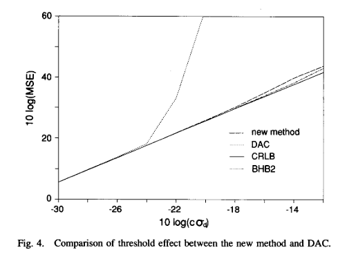
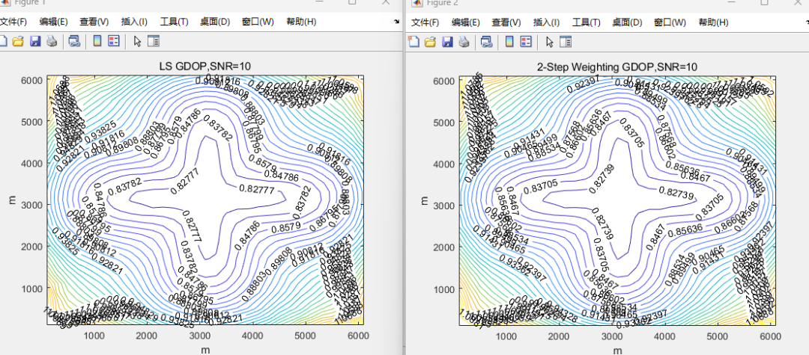

# [TDOA] A Simple and Effective Method for Dual-Axis Orientation Estimation [with MATLAB Code]

Introduction In sonar and radar systems, it is often of interest to determine the position of an object from its emission [1]. Multiple spatially separated sensors capture the transmitted signal and determine the time difference of arrival (TDOA) at the sensor. Using TDOA, the relative position between the transmitter and the sensor can be calculated.
When sensors are arranged linearly, the position is fixed and simplified. Many optimization techniques have been proposed with varying complexity and limitations. Carter's focused beamforming requires searching over a set of possible source positions [1]. Hahn's method-[3] assumes a distant source. Abel and Smith [4] provide an explicit solution that achieves the Cram& Rao Lower Bound (CRLB) within a small error region.
When sensors are distributed randomly, the situation becomes more complex. In this case, the transmitter position is determined based on the intersection of a set of hyperbolas defined by the estimated TDOA. Since the equation is nonlinear, finding the solution is not easy. Fang [5] provides an exact solution when the number of TDOA measurement values equals the number of unknowns (transmitter coordinates). However, this solution does not utilize additional measurements available when there are extra sensors to improve position accuracy. Friedlan considers the more general case of additional measurements. Although closed-form solutions have been developed, their estimates may not be optimal. Abel's divide-and-conquer (DAC) approach [101] can achieve optimal performance but requires sufficient Fisher information. To obtain precise position estimates under reasonable noise levels, the Taylor series method [113-[121] is commonly used. It is an iterative method: it starts with an initial guess and improves each step through determination. The local linear least squares (LS) solution requires an initial guess close to the true solution to avoid local minima. Selecting such an initial point in practice is not straightforward. Moreover, it cannot guarantee convergence. It is also computationally intensive because LS calculations are required in each iteration.
This paper presents a new solution for hyperbolic positioning. The solution is closed-form and effective for both distant and close sources, and serves as an approximation to the maximum likelihood (ML) estimator when the TDOA estimation error is small. To illustrate, Section I1 considers the 2-D positioning problem with an arbitrary array manifold. In the special case of a linear array, the solution is simplified to that given in [4]. By using three sensors to provide two TDOA estimates, an exact solution equivalent to that in [7] was obtained. For four or more sensors, the original TDOA equation set is transformed into another set of equations, which are linear in terms of the source position coordinates and an additional variable. The weighted linear LS provides the initial solution. The second weighted LS takes advantage of known constraints between the source coordinates and the additional variable to provide improved position estimates. The expressions for the variance of position were derived.
Simulation results
Conclusion: A novel time-difference-of-arrival-based hyperbolic sound source positioning method is proposed. Firstly, by introducing an intermediate variable, the nonlinear equation set for TDOA estimates and source position is transformed into a linear set under unknown parameters and intermediate variables. Then, the CTLS technique is utilized to comprehensively consider the presence of pseudorandom signals, and the minimum squares method provides their solutions. By utilizing the known relationship between the intermediate variable and the position coordinates, the second weighted LS gives the final solution for the position coordinates. The covariance matrix of the position estimate is derived, and it conforms to the CRLB. This estimator is asymptotically effective for any or linear array configuration. In fact, when the TDOA error is small, it serves as an approximation to the ML estimator used for hyperbolic positioning. In the case of a linear array, the solution simplifies to that given in [4]. It is compared with other positioning methods. This method has the same simplicity as the SI method but performs significantly better when there are fewer sensors. It has a higher noise threshold than the DAC method and provides an explicit solution form unavailable in existing optimal estimators. Finally, the new technology offers computational advantages through Taylor series techniques and eliminates convergence issues.
This paper only considers the estimation error of time difference. In actual positioning systems, sensor position uncertainty is often encountered [19]. If the variance of uncertainty for each sensor is known, then dividing the inverse variance by itself can be used as a weight in the weighted LS to give an ML estimator which will not be difficult (see discussion after (32)).
MATLAB code simulation

## Images

<!-- PAYMENT_BLOCK -->

## Get this dataset

- Payment link (Stripe): [Buy now](https://buy.stripe.com/3cs8yP7sY87d0vu9AB)
- Payment QR code: 

<!-- /PAYMENT_BLOCK -->
